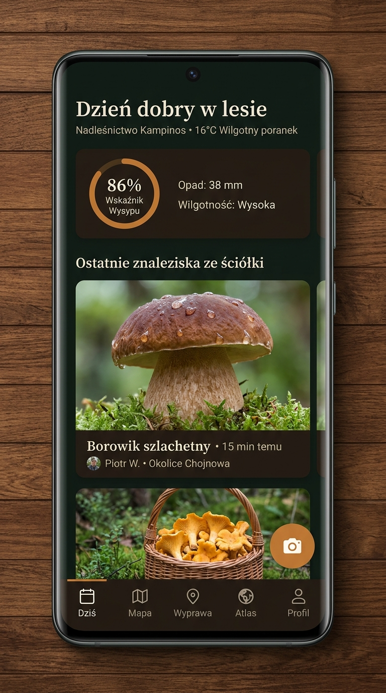

# Toad — Specyfikacja Projektowa UI/UX & Architektura Funkcji

Dokumentacja koncepcji wizualnej, systemu designu oraz planowanych funkcji aplikacji leśno-grzybiarskiej **Toad**.

## Wizualizacja: Koncept 1 (Botanical Photo Journal)



*Główny zaakceptowany koncept wizualny: ciepłe drewno dębowe i orzechowe, głęboka matowa zieleń igliwia sosnowego, zero efektu Matrix / przezroczystości, optymalizacja pod realną fotografię użytkowników i feed znalezisk.*


---

## 1. Filozofia i Kierunek Wizualny: *Forest Sanctuary* (Leśne Ukojenie)

Tradycyjne aplikacje outdoorowe bywają zbyt techniczne, agresywne i przeładowane danymi (jaskrawe neony, gęste wykresy, natarczywe powiadomienia). Projekt **Toad** przyjmuje filozofię inspirowaną japońskim **Shinrin-yoku** (kąpielą leśną) oraz organicznym minimalizmem:

- **Uspokajająca prostota**: Aplikacja ma sprawiać wrażenie cichego, naturalnego towarzysza w lesie — nie rozprasza, nie wymusza uwagi, wycisza bodźce.
- **Nawiązanie do natury**: Barwy ściółki leśnej, wilgotnego mchu, kory dębów i sosen, porannej mgły oraz ciepłego światła słonecznego przebijającego przez korony drzew.
- **Ergonomia w terenie (Field-First UX)**: Zaprojektowana do obsługi jedną ręką (w drugiej ręce użytkownik niesie koszyk lub nożyk), z czytelnym kontrastem w ostrym słońcu i w gęstym cieniu drzew.

---

## 2. System Designu (Design System Tokens)

### 2.1. Paleta Barw (Earthy & Calming Palette)

Zastosowano system Material You 3 dostosowany do leśnego charakteru z podziałem na tryb ciemny (optymalny w lesie, oszczędzający baterię OLED) oraz tryb jasny (do planowania w domu i przy pełnym słońcu).

#### Tryb Ciemny (*Głęboki Bór / Deep Forest*)
| Token semantyczny | Kolor Hex | Przeznaczenie |
|---|---|---|
| `background` | `#0C1610` | Głęboka, uspokajająca czerń sosnowego igliwia |
| `surface` | `#132219` | Powierzchnie kart, arkuszy dolnych (bottom sheet) |
| `surfaceVariant` | `#1B2E23` | Wewnętrzne pola, karty podrzędne, wyszukiwarki |
| `primary` | `#52B788` | Żywy, kojący odcień młodego mchu (główne akcje, FAB) |
| `primaryContainer` | `#2D6A4F` | Tła aktywnych elementów menu, zaznaczone filtry |
| `onPrimaryContainer`| `#D8F3DC` | Etykiety i ikony na ciemnozielonym tle |
| `secondary` | `#D4A373` | Ciepły brąz kory borowika (akcenty, trasy, parametry) |
| `secondaryContainer`| `#3F2B1D` | Subtelne tła sekcji informacyjnych i tagów |
| `accentMushroom` | `#E76F51` | Ciepła terakota / borowik ceglastopory (ważne alerty, pin auta) |
| `textPrimary` | `#E8F1EC` | Miękka biel z nutą szałwii (brak oślepiającej czystej bieli) |
| `textSecondary` | `#A3B899` | Wyciszony szałwiowy szary (opisy, metadane) |

#### Tryb Jasny (*Poranna Polana / Morning Clearing*)
| Token semantyczny | Kolor Hex | Przeznaczenie |
|---|---|---|
| `background` | `#F7F9F6` | Jasny, kremowy odcień porannej mgły |
| `surface` | `#FFFFFF` | Czyste karty z subtelnym, ciepłym cieniem |
| `surfaceVariant` | `#E8EFE9` | Tła pól formularzy, chipy nieaktywne |
| `primary` | `#2D6A4F` | Szmaragdowy, głęboki leśny zielony |
| `primaryContainer` | `#D8F3DC` | Świeży, miętowo-leśny pastel |
| `secondary` | `#8C5E3B` | Ciepły orzech laskowy / dąb |
| `accentMushroom` | `#D9534F` | Stonowana czerwień naturalna |

---

### 2.2. Typografia i Rytm

Harmonijne połączenie klasycznego, organicznego szeryfu z ultra-czytelnym sans-serifem:
- **Nagłówki (Display & Headlines)**: `Fraunces` lub `Newsreader` – ciepły, lekko zaokrąglony font szeryfowy, nawiązujący do klasycznych atlasów botanicznych z XIX wieku.
- **Treść i interfejs (Body, Label, UI)**: `Plus Jakarta Sans` lub `DM Sans` – geometryczny, łagodny bezszeryf o doskonałej czytelności w małych rozmiarach.
- **Siatka (Grid)**: Baza 8dp (z 4dp dla mikro-odstępów). Marginesy ekranu: 16dp / 20dp dla poczucia przestrzeni i oddechu.
- **Zaokrąglenia (Radii)**: Miękkie, organiczne narożniki (karty 16dp, przyciski i pigułki 24dp–28dp, arkusze dolne 28dp).

---

### 2.3. Dźwięki i Haptyka (Sensory Experience)
- **Haptyka**: Bardzo delikatne, tępe impulsy wibracyjne przy zapisywaniu punktu lub ukończeniu trasy (uczucie przypominające naciśnięcie miękkiego mchu, a nie ostry brzęczyk).
- **Akustyka (opcjonalnie)**: Dyskretny, cichy dźwięk liści lub kropelki rosy przy pomyślnym dodaniu znaleziska do koszyka.

---

## 3. Architektura Informacji i Główne Funkcje

Aplikacja zorganizowana jest wokół 5 intuicyjnych modułów dostępnych z dolnego paska nawigacji:

```mermaid
flowchart TD
    App([Toad: Leśny Przewodnik])
    
    App --> Tab1[1. Las Dzisiaj\nFeed & Warunki]
    App --> Tab2[2. Mapa Leśna\nOdkrywanie & Trasy]
    App --> Tab3[3. Wyprawa\nTryb Terenowy GPS]
    App --> Tab4[4. Atlas Grzybów\nIdentyfikacja & Porady]
    App --> Tab5[5. Mój Las\nZielnik, Koszyk & Historia]

    Tab1 --> W1[Indeks Szansy na Grzyby]
    Tab1 --> W2[Pogoda & Wilgotność Ściółki]
    Tab1 --> W3[Co teraz rośnie w Twojej okolicy]

    Tab2 --> M1[Warstwa Drzewostanu: Iglasty/Liściasty]
    Tab2 --> M2[Znaleziska Społeczności z ochroną GPS]
    Tab2 --> M3[Heatmapa Wilgoci i Prawdopodobieństwa]

    Tab3 --> T1[Lokalizator Auta / Punkt Startu]
    Tab3 --> T2[Nawigacja powrotu Breadcrumbs]
    Tab3 --> T3[Szybki Pin Znaleziska + Foto]
    Tab3 --> T4[Zegar Zachodu Słońca]

    Tab4 --> A1[Wyszukiwarka z filtrem jadalności]
    Tab4 --> A2[Bliźniaki: Bezpieczne Porównywarki]
    Tab4 --> A3[Kalendarz Sezonowości]

    Tab5 --> P1[Prywatne Miejscówki]
    Tab5 --> P2[Statystyki Czasu w Naturze]
    Tab5 --> P3[Historia Przebytych Tras]
```



---

## 4. Szczegółowy Projekt Ekranów i Funkcjonalności

### 4.1. Ekran 1: Pulpit "Las Dzisiaj" (Home & Weather Feed)

Centrum dowodzenia przed wyjściem w teren. Odpowiada na pytanie: *"Czy warto dzisiaj iść do lasu i co w nim znajdę?"*.

#### Elementy interfejsu:
1. **Nagłówek atmosferyczny**:
   - Przywitanie w stylu: *"Wilgotny poranek w Puszczy Kampinoskiej."*
   - Miniaturowa animacja mgły lub delikatnych promieni słońca.
2. **Karta "Wskaźnik Leśny" (Mushroom Favorable Index)**:
   - Okrągły, organiczny wskaźnik procentowy (np. `78% – Doskonałe warunki na borowiki`).
   - Podsumowanie czynników: opady z ostatnich 14 dni (np. *32 mm deszczu w tym tygodniu*), temperatura ściółki (14°C), faza księżyca.
3. **Sezonowe Grzyby Tygodnia (Karuzele kart)**:
   - Horyzontalna lista gatunków, które aktualnie owocują w danym regionie (np. *Borowik szlachetny, Maślak zwyczajny, Pieprznik jadalny*).
   - Etykieta statusu: `Wysoki wysyp`, `Początek sezonu`, `Schyłek`.
4. **Społeczność: "Wieści ze Ściółki"**:
   - Zdjęcia znalezionych okazów od innych grzybiarzy z okolicy.
   - **Kluczowa zasada prywatności**: Dokładna lokalizacja znaleziska jest celowo rozmyta do bezpiecznego promienia (np. *Znaleziono w promieniu 15 km od Nadleśnictwa Chojnów*), aby chronić sekretne grzybowe miejscówki użytkowników!

---

### 4.2. Ekran 2: Mapa Leśna (Interactive Forest Map)

Mapa nie przypomina miejskiej nawigacji drogowej — to artystyczna, uspokajająca mapa topograficzna bazująca na MapLibre i danych OpenStreetMap.

#### Funkcje mapy:
- **Filtrowanie rodzajów lasów**:
   - Kolorystyczne rozróżnienie drzewostanu: ciemna zieleń = lasy iglaste (sosna, świerk — raj dla borowików i podgrzybków), soczysta zieleń = lasy liściaste (dąb, buk, grab — koźlarze, borowiki usiatkowane), zieleń oliwkowa = lasy mieszane.
- **Warstwa Heatmapy Grzybowej**:
   - Płynne, łagodne plamy wskazujące obszary o najwyższej wilgotności gleby i optymalnej temperaturze według modeli satelitarnych i stacji meteorologicznych.
- **Pobieranie Offline jednym tapnięciem**:
   - Przycisk *"Zapisz ten rejon offline"* — kluczowy w lasach pozbawionych zasięgu GSM.

---

### 4.3. Ekran 3: Tryb Aktywnej Wyprawy (Active Trip Mode)

Ekran, który włącza się po wejściu do lasu. Projektowany z myślą o minimalnym zużyciu energii i absolutnym spokoju.

```
+-----------------------------------------------------+
|  [X Zakończ]       Wyprawa: 02:14:05     [Latarka]  |
|                                                     |
|                  KOMPAS LEŚNY (210° SW)             |
|                                                     |
|                     ^                               |
|                  /     \                            |
|                 /   |   \                           |
|                    ---                              |
|           Samochód: 1.2 km (Azymut 45°)             |
|                                                     |
|  [ Pokaż ślad na mapie ]        Zachód za: 1h 45m   |
|                                                     |
|  +-----------------------------------------------+  |
|  |                ZNALAZŁEŚ GRZYBA?              |  |
|  |     [ ( + ) Oznacz punkt i zrób zdjęcie ]     |  |
|  +-----------------------------------------------+  |
|                                                     |
|  Dystans: 4.8 km    Kroki: 6 820    W koszyku: 14   |
+-----------------------------------------------------+
```

#### Kluczowe elementy bezpieczeństwa i komfortu:
1. **Kotwica "Gdzie jest auto?" (Car Anchor)**:
   - Przy starcie wyprawy aplikacja automatycznie pyta: *"Czy zapisałeś miejsce zaparkowania samochodu / wejścia do lasu?"*.
   - W trakcie spaceru stale wyświetla subtelną strzałkę z odległością w linii prostej i podpowiedzią powrotu po własnych śladach (*Breadcrumbs*).
2. **Kalkulator Zmierzchu (Sunlight Watchdog)**:
   - W lesie zmrok zapada o 30-40 minut wcześniej niż na otwartej przestrzeni. Aplikacja informuje: *"Zmierzch w lesie o 16:20. Czas na powrót za 40 minut."*.
3. **Ekspresowe Dodawanie Okazu (One-Tap Catch)**:
   - Duży, wygodny przycisk dolny pozwala w 3 sekundy zapisać współrzędne, zrobić zdjęcie i przypisać gatunek do wirtualnego koszyka.

---

### 4.4. Ekran 4: Inteligentny Atlas Grzybów (Field Species Guide)

Kieszonkowa encyklopedia działająca w 100% offline. Zamiast suchego tekstu – przejrzysta, wizualna identyfikacja.

#### Funkcje i UX:
- **Karty gatunków**:
   - Zdjęcie w naturalnym środowisku (kapelusz z góry, hymenofor/blaszki/rurki, trzon, przekrój).
   - Odznaki bezpieczeństwa w stonowanych barwach:
     - 🟢 *Smaczny jadalny*
     - 🟡 *Niejadalny (gorzki/twardy)*
     - 🔴 *Trujący*
     - ☠️ *Śmiertelnie niebezpieczny*
- **Sekcja "Nie pomyl z..." (Side-by-Side Comparison)**:
   - Najważniejsza funkcja bezpieczeństwa: bezpośrednie zestawienie cech odróżniających (np. *Kania vs Muchomor Sromotnikowy*, *Kurka vs Lisówka Pomarańczowa*).
   - Wskazówki dotykowe: ruchomy pierścień, bulwa, zapach, próba smakowa (jeśli bezpieczna).
- **Filtry anatomiczne**:
   - Zamiast wpisywać nazwę, użytkownik wybiera cechy: *Rurki czy blaszki?*, *Jaki kolor kapelusza?*, *Drzewa w pobliżu (sosna czy brzoza?)*.

---

### 4.5. Ekran 5: Mój Las (Personal Herbarium & Journal)

Prywatne archiwum grzybiarza i statystyki bliskości z naturą.

- **Wirtualny Koszyk i Historia Wypraw**: Podsumowanie każdego wyjścia: mapa przejścia, galeria zebranych okazów, profil wysokościowy.
- **Moje Tajne Miejscówki (Secret Spots)**: Szyfrowane, lokalne punkty na mapie oznaczone własnymi nazwami (np. *"Dęby przy bagnie - borowiki"*, *"Młody zagajnik - maślaki"*). Te dane nigdy nie opuszczają urządzenia bez wyraźnej zgody użytkownika.
- **Wskaźnik "Reset w Naturze"**: Statystyka godzin spędzonych na świeżym powietrzu w leśnej ciszy (zdrowy akcent wellbeing zamiast agresywnej grywalizacji).

---

## 5. Dobre Praktyki UX w Środowisku Leśnym

1. **Brak agresywnych powiadomień (Peaceful Mode)**: Aplikacja nie wysyła zbędnych pushy reklamowych ani komunikatów marketingowych. Powiadomienia dotyczą wyłącznie bezpieczeństwa (np. zbliżający się zmrok, nadchodzący deszcz).
2. **Optymalizacja pod rękawiczki i wilgotne dłonie**: Elementy klikalne o minimalnej wysokości `56dp`, z dużymi strefami dotyku (`touch targets`).
3. **Automatyczne maskowanie lokalizacji w chmurze**: Wszelkie zdjęcia publikowane na forum społeczności mają automatycznie usuwane metadane EXIF (dokładny GPS i model aparatu) w celu ochrony prywatności i zapobiegania "najazdom" na prywatne lasy.
